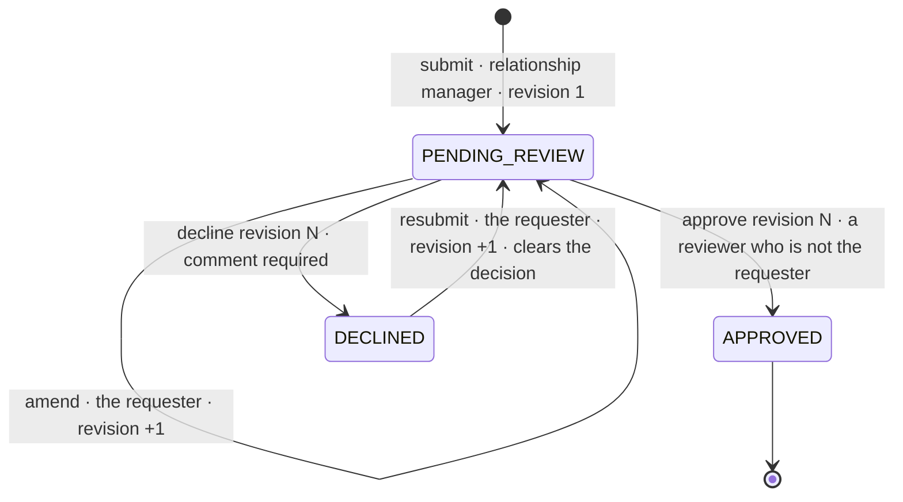

# ADR 0001: Revisioned requests

Accepted, 17 October 2026.

## Context

Two stakeholders disagree. One wants a relationship manager to keep amending the discount once a request is in.
The other wants every approval tied to precisely the terms the reviewer looked at. Both are
reasonable: a manager learns new facts (a competitor improves an offer), and a reviewer must never approve terms
that changed under their eyes, because the approved discount changes what a borrower pays.

## Decision

A request is a sequence of numbered **revisions**, and every decision names the revision it judges.

- **Changing is allowed** while the request is pending, and after a decline. Every change is complete terms
  (discount and reason) and becomes the next revision. Only the manager who made the request may change it.
- **Deciding binds to a revision.** The reviewer sends the revision they saw. Anything but the current revision is
  refused with 409 `stale-revision`, and the answer carries `current`, the request as it is now, so the reviewer
  sees the new terms before deciding again.
- **Approved is final.** An approved request never changes, so the mortgage process reads one answer it can trust.
- **Declined is not final.** The requester answers a decline with new terms (a resubmission), which go back to
  review. With one request per application ([ADR 0002](0002-idempotent-create.md)), a final decline would lock the
  application for ever, and a request's history could never hold more than one decision.
- **Four-eyes.** "Authorised reviewer" is read as: the REVIEWER role, and not the person who made the request. One
  user may hold both roles (lead.fatima in the seed data) and still cannot decide their own request.
- **History keeps everything.** Every revision and every decision is an event, written in the same transaction as
  the change; nothing is ever updated or deleted there.

The demo (`docs/demo.http`, steps 6 to 9) shows both stakeholders in one story: rv.dana reads revision 1 at 25 bps,
lead.fatima changes it to 30 bps, rv.dana's approval of revision 1 gets 409, and her approval of revision 2 lands.

## Consequences

- Clients send the revision they saw. A typo fix starts a new review.
- **A change written before a decline lands as a resubmission** (audit finding F13). The revision check protects
  the reviewer from stale terms; it does not tell the requester that a decline arrived while they were typing. We
  accept this: a resubmission only asks for a new review, nothing is approved until a reviewer names that revision,
  and the answer and the history show the decline. Each writer reads the clock under the row lock, so the
  resubmission's time is never earlier than the decline's. Refusing such a change would need a version that
  decisions also advance; that is a later option, not something the client asked for.
- **Declined terms may come back unchanged**, to any reviewer but the requester (F14). The decline stays in the
  history and in `latest_decision`, where the next reviewer sees it. Refusing identical resubmissions, or routing
  them to the reviewer who declined, belongs with an authority matrix the client owns
  ([production readiness](../production-readiness.md), items 2 and "later").
- After approval nothing changes, so a re-pricing needs a supersede or withdraw rule that does not exist yet
  (production readiness, item 4).

## Alternatives considered

| Alternative | Why not |
| --- | --- |
| Freeze a request once submitted | Fails the first stakeholder |
| Let the reviewer edit the terms (a counter-offer) | The reviewer would approve terms they wrote themselves, which breaks four-eyes. A decline comment ("up to 30 bps acceptable") and a resubmission do the same with one more round trip |
| PATCH on the request, inferring the action from the fields | Each change is a business action with its own permission and history event; with PATCH a client could try to set `status`. Named actions (`/revisions`, `/decisions`) keep that explicit |
| A hidden version column for concurrency | The revision number already exists and means something to people; [ADR 0003](0003-concurrency-control.md) explains how concurrent writers are handled |
| DECLINED as a final state | Simpler, but with one request per application the application could never be priced again |
