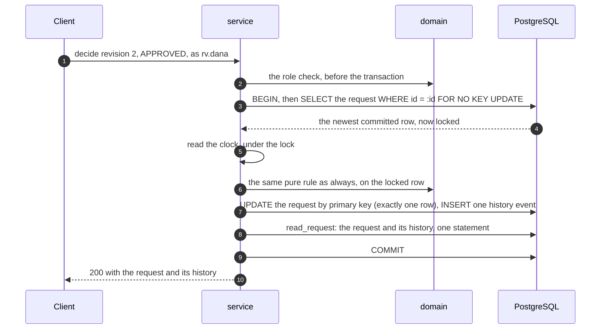

# ADR 0003: Concurrency control with a row lock

Accepted, 17 October 2026.

## Context

Two writers can act on one request at once: two reviewers deciding, or a manager's change racing a reviewer's
approval. Exactly one must win, and the other must get a precise 409 that shows the winner's result: never a 500,
and never a lost update, where both calls answer 200 and one change silently disappears.

## Decision

Every revise and decide is one transaction at READ COMMITTED, in this order:

- **The lock is taken by primary key only**, with `FOR NO KEY UPDATE`. A second writer waits for the first to
  commit, then PostgreSQL hands it the newest committed row, and the same rule refuses it: `invalid-state` after an
  approval, `stale-revision` after an amendment. Its 409 carries `current`, read under the lock.
- **The clock is read under the lock**, so times in the history follow the order in which writers took it.
- **Waiting is bounded:** `lock_timeout` 2 seconds, then 503 with `Retry-After: 1` and nothing written
  ([architecture](../architecture.md), "Time limits").
- **No network call while the lock is held.** Production lookups (loan origination, identity) happen before the
  transaction.
- **The database backs the rule up.** If a future code path forgets the lock, unique indexes still refuse a second
  decision on one revision (`ux_event_one_decision_per_revision`) and a revision number created twice
  (`ux_event_one_revision_event`); checks refuse a requester deciding their own request and decision columns that
  do not match the status ([architecture](../architecture.md), "Data model").

`FOR NO KEY UPDATE` is the lock strength a change to non-key columns needs. Unlike `FOR UPDATE`, it does not
conflict with the share lock a foreign-key check takes, so it cannot cause lock-upgrade deadlocks.

## Evidence

Deterministic race tests on a real PostgreSQL (`tests/integration/test_races.py`): the test's own connection takes
the lock and holds it, the real API call starts in a thread, and a barrier polls `pg_stat_activity` until that
call is waiting on the lock. Then the test commits its own change and checks the exact outcome. No sleeps and no
luck. With `FOR NO KEY UPDATE` removed as a temporary edit, 6 of the 11 race cases failed, and three of them were
silent lost updates answered 200 ([agentic SDLC](../agentic-sdlc.md), "Red runs").

## Consequences

- A lock is held while a few lines of Python run: microseconds here. A waiter holds a thread and a database
  connection for at most 2 seconds.
- The lock covers one row, so writers on different requests never wait for each other. Several app instances are
  safe, because the lock and every invariant live in PostgreSQL, not in memory.
- READ COMMITTED must stay pinned on the engine; the create replay ([ADR 0002](0002-idempotent-create.md)) relies
  on it too. A test asserts it on a pooled connection.

## Alternatives considered

| Alternative | Why not |
| --- | --- |
| A version column with compare-and-set (optimistic locking) | Lock-free and familiar, but a second counter beside the revision and a separate failure path for a lost race. The revision already guards the minutes a reviewer spends reading; the lock only covers the microseconds of the write |
| SERIALIZABLE or REPEATABLE READ | A conflict becomes a serialization failure the server must retry. With the engine at REPEATABLE READ, as a temporary edit, every waiter in the race tests got 503 |
| `FOR UPDATE` | Stronger than a non-key change needs, and it conflicts with foreign-key checks |
| Rely on the unique indexes alone | They stop a second decision, but a change racing an approval would surface as a 500, not a precise 409 |
